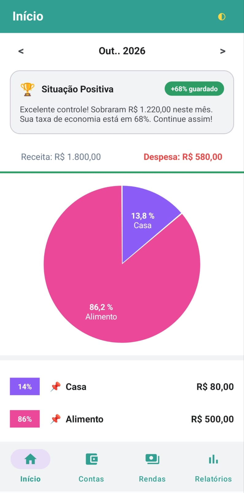
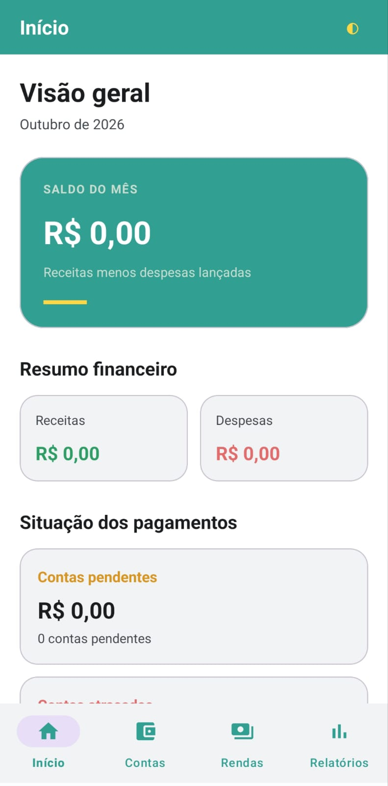
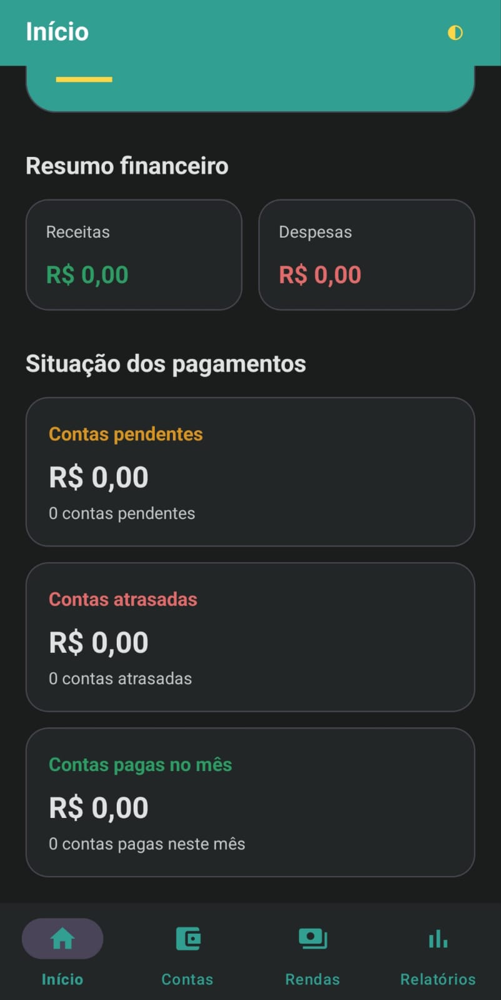
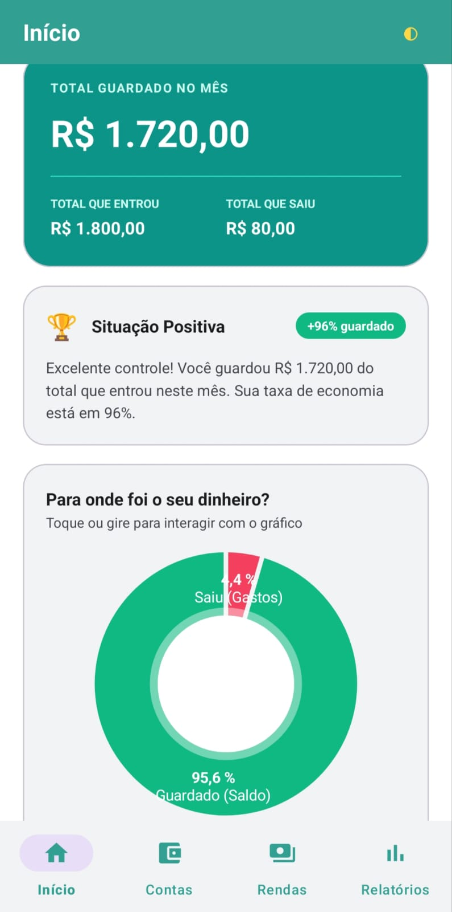
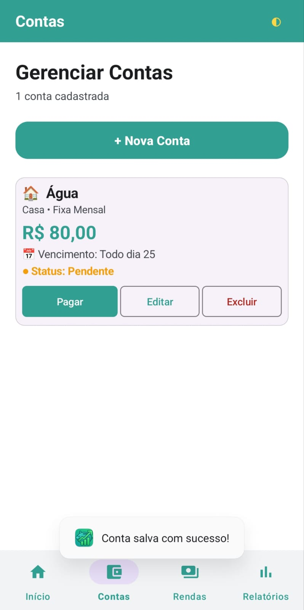
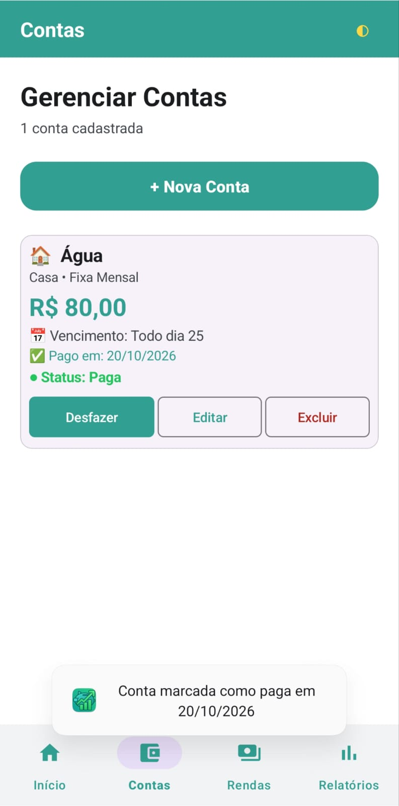
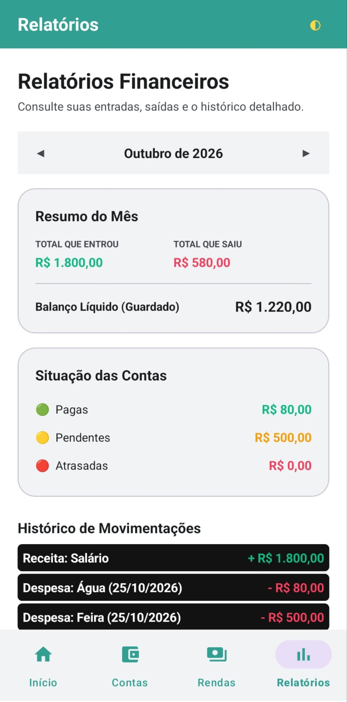

<h1 align="center">💰 PlanWin</h1>

<p align="center">
  <strong>Planejamento financeiro pessoal simples, bonito e 100% offline para Android.</strong><br>
  Controle suas contas, registre suas rendas e descubra para onde seu dinheiro está indo.
</p>

<p align="center">
  
  
  
  
  
  
</p>

<p align="center">
  
</p>

---

## 📖 Sobre o projeto

O **PlanWin** é um aplicativo Android de organização financeira pessoal. Ele permite cadastrar **contas a pagar** (fixas mensais ou pontuais) e **rendas** (salário, extras, investimentos), acompanhar o **status de cada pagamento** e visualizar o **balanço do mês** em gráficos e relatórios claros.

Todos os dados ficam salvos **localmente no aparelho** (SQLite). O app não pede nenhuma permissão e não precisa de internet.

## ✨ Funcionalidades

### 🏠 Início
- Visão geral do mês com **saldo** (receitas − despesas).
- Cartões de **receitas** e **despesas** do mês.
- **Situação dos pagamentos**: contas pendentes, atrasadas e pagas, com valor total e quantidade.
- Toque nos cartões para abrir o **dashboard** com gráficos interativos.

### 📊 Dashboard
- **Gráfico de pizza** com as despesas por categoria (toque ou gire para interagir).
- **Gráfico de rosca** "Para onde foi o seu dinheiro?" comparando o que foi guardado com o que foi gasto.
- **Mensagem de situação financeira** com a taxa de economia do mês (ex.: *"+68% guardado"*).
- Navegação entre meses.

### 🧾 Contas
- Cadastro, edição e exclusão de contas.
- Dois tipos: **Fixa mensal** (vence todo mês em um dia definido) e **Conta do mês** (lançamento pontual).
- **Categorias** com ícone: Casa 🏠, Alimento 🛒, Saúde, Carro 🚗, Viagem ✈️, Roupa 👕, Cartão e Outro 📦.
- Botão **Pagar / Desfazer**, que registra a data do pagamento.
- Status calculado automaticamente: **Pendente**, **Atrasada** (vencimento já passou) ou **Paga**.
- Validação contra cadastros duplicados (mesmo nome e valor).

### 💵 Rendas
- Cadastro, edição e exclusão de rendas.
- Tipos **Fixa** (dia de recebimento mensal) e **do Mês**.
- Categorias: Salário, Extra, Investimento e Outro.

### 📈 Relatórios
- **Resumo do mês**: total que entrou, total que saiu e balanço líquido.
- **Situação das contas**: valores pagos, pendentes e atrasados.
- **Histórico de movimentações** detalhado, com receitas e despesas.
- Navegação mês a mês.

### 🎨 Extras
- **Tema claro e escuro** alternável com um toque, com a escolha salva no aparelho.
- Layout **edge-to-edge** moderno, com navegação inferior (Início, Contas, Rendas, Relatórios).

## 📱 Telas

<table align="center">
  <tr>
    <td align="center">
      <br>
      <sub><b>Visão geral</b><br>Tema claro</sub>
    </td>
    <td align="center">
      <br>
      <sub><b>Resumo financeiro</b><br>Tema escuro</sub>
    </td>
    <td align="center">
      <br>
      <sub><b>Despesas por categoria</b><br>Gráfico de pizza</sub>
    </td>
  </tr>
  <tr>
    <td align="center">
      <br>
      <sub><b>Total guardado</b><br>Gráfico de rosca</sub>
    </td>
    <td align="center">
      <br>
      <sub><b>Conta pendente</b><br>Botão "Pagar"</sub>
    </td>
    <td align="center">
      <br>
      <sub><b>Conta paga</b><br>Botão "Desfazer"</sub>
    </td>
  </tr>
  <tr>
    <td align="center" colspan="3">
      <br>
      <sub><b>Relatórios financeiros</b><br>Resumo, situação das contas e histórico</sub>
    </td>
  </tr>
</table>

## 🛠️ Tecnologias

| Categoria | Tecnologia |
|---|---|
| Linguagem | Java 11 |
| Plataforma | Android (minSdk 26 · targetSdk/compileSdk 37) |
| Build | Gradle 9.6.0 (Kotlin DSL) · Android Gradle Plugin 9.4.1 |
| Interface | AndroidX AppCompat, ConstraintLayout, RecyclerView, Fragments |
| Design | [Material Components](https://github.com/material-components/material-components-android) 1.12.0 |
| Gráficos | [MPAndroidChart](https://github.com/PhilJay/MPAndroidChart) v3.1.0 (via JitPack) |
| Persistência | SQLite (`SQLiteOpenHelper`, schema na versão 5) |
| Preferências | `SharedPreferences` (tema claro/escuro) |
| Testes | JUnit 4.13.2 · AndroidX Test · Espresso 3.7.0 |

## 🏗️ Arquitetura

O código é organizado em camadas dentro do pacote `com.example.planwin`:

```
app/src/main/java/com/example/planwin/
├── MainActivity.java          # Navegação inferior, tema e troca de fragments
├── database/
│   └── PlanWinDatabase.java   # SQLiteOpenHelper: criação e migrações (v1 → v5)
├── entity/                    # Modelos: Conta, Renda, ResumoFinanceiro, Usuario
├── enums/
│   └── StatusPagamento.java   # PENDENTE, ATRASADA, PAGA
├── repository/                # Acesso ao SQLite: ContaRepository, RendaRepository
├── service/                   # Regras de negócio: ServiceConta, ServiceRenda
└── ui/
    ├── home/                  # Tela inicial e lista filtrada de contas (bottom sheet)
    ├── contas/                # Gerenciamento de contas
    ├── rendas/                # Gerenciamento de rendas
    ├── relatorios/            # Relatórios mensais
    └── dashboard/             # Dashboards com gráficos (saldo, receitas, despesas)
```

**Fluxo geral:** `Fragment (UI)` → `Service (regras)` → `Repository (dados)` → `SQLite`.

### Banco de dados

O banco `planwin.db` possui três tabelas:

| Tabela | Descrição |
|---|---|
| `contas` | Nome, valor, vencimento (data ou dia fixo), lançamento, tipo, categoria, status e data de pagamento |
| `rendas` | Nome, valor, mês, dia de recebimento fixo, tipo, categoria e descrição |
| `resumos_financeiros` | Totais de lucro, despesa e saldo por mês (`mes_ano` único) |

Os valores monetários usam `BigDecimal` no código e são gravados como texto, para evitar erros de arredondamento. As migrações de versão preservam os dados já existentes.

## 🚀 Como executar

### Pré-requisitos
- [Android Studio](https://developer.android.com/studio) em versão recente, compatível com o AGP 9.4.1.
- Android SDK com a plataforma **API 37** instalada.
- Um emulador ou aparelho com **Android 8.0 (API 26)** ou superior.

> O projeto usa o *Gradle daemon toolchain* com JDK 25, que o próprio Gradle baixa automaticamente na primeira execução (é necessária conexão com a internet nesse momento).

### Passo a passo

```bash
# 1. Clone o repositório
git clone https://github.com/<seu-usuario>/PlanWin.git
cd PlanWin

# 2. Gere o APK de debug
./gradlew assembleDebug          # Linux / macOS
gradlew.bat assembleDebug        # Windows
```

O APK será gerado em `app/build/outputs/apk/debug/app-debug.apk`.

Ou, pelo Android Studio:

1. Abra a pasta do projeto com **File ▸ Open**.
2. Aguarde a sincronização do Gradle.
3. Selecione um emulador ou aparelho e clique em **Run ▶**.

### Testes

```bash
./gradlew test                   # Testes unitários
./gradlew connectedAndroidTest   # Testes instrumentados (exige emulador/aparelho)
```

## 🗺️ Roadmap

Ideias para próximas versões:

- [ ] Notificações de lembrete para contas perto do vencimento
- [ ] Exportação de relatórios (PDF / CSV)
- [ ] Backup e restauração dos dados
- [ ] Metas de economia por categoria
- [ ] Contas parceladas
- [ ] Migração para Room e testes automatizados das regras de negócio

## 🤝 Contribuindo

Contribuições são bem-vindas!

1. Faça um fork do projeto.
2. Crie uma branch: `git checkout -b feature/minha-feature`
3. Faça o commit: `git commit -m "feat: minha feature"`
4. Envie para a branch: `git push origin feature/minha-feature`
5. Abra um Pull Request.

## 📄 Licença

Este projeto está sob a licença MIT. Veja o arquivo [LICENSE](LICENSE) para mais detalhes.

## 👤 Autor

Desenvolvido por **Luciano Cleberton Ribeiro Leite Junior**.

- GitHub: [@Lucianooli](https://github.com/Lucianooli)
